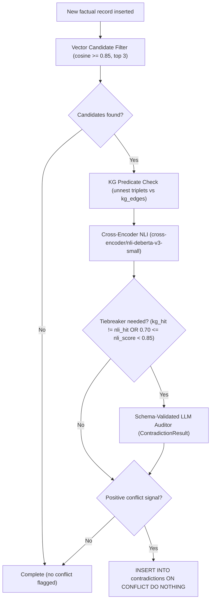
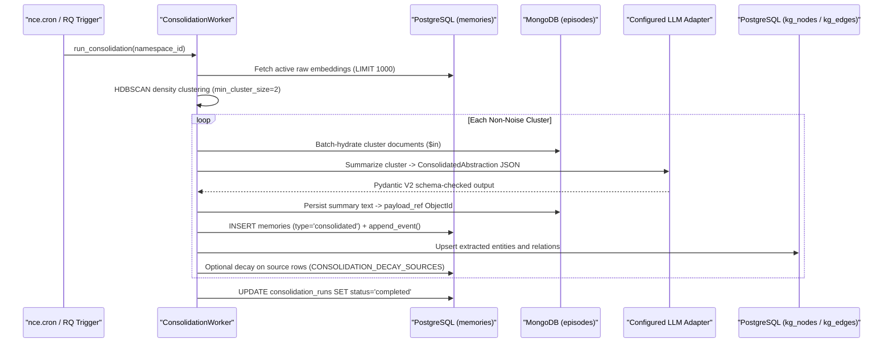

> **Status:** shipped · **Verified-against:** 236e4dc (main) · **Last-audited:** 2026-11-19

# Hybrid Retrieval, Graph Traversal, Contradiction Detection & Background Summarization

> **Note on Legacy Identifiers:** This file retains the path `docs/cognitive_layer.md` and documents legacy code/SQL identifiers (`salience`, `memory_salience`, `episodic`, `semantic`, `consolidation_runs`, `neuromorphic_search`) preserved for API and schema stability. Each identifier is defined below in terms of its concrete SQL query, ranking formula, or background worker pipeline.

This guide documents NCE's retrieval ranking, recursive graph traversal, time-decay scoring, conflict detection, assumption-based dependency tracking (`ATMS`), and scheduled background summarization jobs.

---

## 1. Hybrid Retrieval & Multi-Tier Context Assembly

### 1.1 Three-Way Reciprocal Rank Fusion (`semantic_search`)

Pure cosine similarity over dense embeddings frequently under-ranks exact part numbers, SKUs, organization identifiers, and regulatory clause numbers. `semantic_search` (`nce/engine.py`) combines three retrieval signals inside a single `scoped_pg_session` transaction:

1. **Dense Vector Branch (`pgvector` HNSW):** Cosine distance (`embedding <=> $query_vec`) over `halfvec(768)` HNSW indexes with `hnsw.iterative_scan = 'relaxed_order'` so tenant/temporal filters do not starve top-$k$ candidate recall.
2. **Lexical Full-Text Branch (`tsvector` GIN):** `ts_rank_cd` over trigger-maintained `search_tsv` GIN indexes on `memories`.
3. **Exact Identifier Boost:** Deterministic rank bonus when query tokens match structured identifier patterns (SKUs, IP addresses, organization numbers, or exact entity codes).

Candidate lists are merged via **Reciprocal Rank Fusion (RRF)**:

$$\text{RRF}(d) = \sum_{r \in \{\text{vec}, \text{fts}, \text{id}\}} \frac{w_r}{k + \text{rank}_r(d)}$$

with smoothing constant $k = 60$, modulated by each record's current `salience_score` and filtered by temporal validity (`valid_from <= as_of AND (valid_to IS NULL OR valid_to > as_of)`). Matched `payload_ref` document bodies are hydrated in a single batched MongoDB `$in` query (`AES-256-GCM` decrypted if `TCDEK\x01` envelope-encrypted).

### 1.2 Multi-Tier Context Compilation (`compile_working_memory`)

`compile_working_memory` (MCP tool `#71`) executes a coalesced read across four PostgreSQL/MongoDB record classes in one RLS-scoped session:

- **Raw interaction & document records (`episodic`):** Timestamped source observations and ingested file chunks.
- **Distilled reference summaries (`semantic` / `consolidated`):** Cluster summaries produced by `ConsolidationWorker` with `supporting_memory_ids` lineage.
- **Knowledge Graph Neighborhood (`kg_nodes` / `kg_edges`):** Multi-hop entity relationships anchored to top vector matches.
- **Validation & Operational Rules (`procedural_heuristics`):** Trigger/condition/guidance rules extracted from reviewed decisions and indexed via FTS GIN.

Each response returns calibrated `confidence_score` and `epistemic_warnings` metadata (for example, warning the caller when returned records have unresolved entries in `contradictions` or low top-1 similarity).

---

## 2. Weighted Multi-Hop Graph Traversal (`graph_search` & `neuromorphic_search`)

Knowledge-graph triplets are stored in `kg_nodes` and `kg_edges` under forced PostgreSQL RLS. NCE provides two SQL-backed graph traversal paths:

1. **Breadth-First Subgraph Retrieval (`graph_search`):** Anchors start nodes via vector similarity or trigram match (`idx_kg_edges_combined_trgm`), then executes a cycle-safe `WITH RECURSIVE` CTE up to `max_depth` hops, tracking visited node arrays (`NOT (next_node_id = ANY(visited))`) to guarantee termination on cyclic graphs.
2. **Weighted Decay Traversal (`neuromorphic_search`):** Executes a weighted `WITH RECURSIVE` propagation query (referred to in legacy code as `spreading_activation`) where path weight attenuates at each hop by edge weight $w_{ij} \in (0, 1]$ and hop decay factor $\gamma$, pruning branches below an activation threshold. Co-retrieved edges increment access counters (`nce/kg_weights.py`) with bounded upper/lower clamping so frequently traversed paths rank higher without unbounded weight drift.

---

## 3. Configurable Time-Decay & Access-Frequency Scoring (`salience`)

The `nce/salience.py` module implements configurable exponential time-decay and access-frequency reinforcement over `memory_salience` so stale, unreferenced records gradually rank below actively referenced context.

### 3.1 Exponential Time-Decay Formula

Every record's `salience_score` $\in [0.0, 1.0]$ decays according to:

$$s(t) = s_{\text{last}} \cdot \exp(-\lambda \cdot \Delta t_{\text{days}}), \quad \lambda = \frac{\ln(2)}{\text{half\_life\_days}}$$

- `CONSOLIDATION_HALF_LIFE_DAYS` sets the base half-life (default `30.0` days).
- A deterministic $\pm 5\%$ per-record jitter derived from `SHA-256(memory_id)` spreads expiration timestamps so background pruning does not contend on identical timestamps.
- Numerical guards in `nce/salience.py`: `half_life_days <= 0` disables decay (`s_last` unchanged); negative clock skew (`delta_t < 0`) is clamped to `0.0`; large exponents are clamped at `709.0` to prevent `OverflowError`.

### 3.2 Coalesced Read-Path Reinforcement

When a record is retrieved or explicitly boosted via `boost_memory`, its score updates via:

$$s_{\text{new}} = \min(1.0,\; s_{\text{current}} + \delta)$$

(`factor` default `0.2`). On hot `/mcp` read paths, `memory_salience` updates are buffered in an async ring buffer and flushed in batches so read latency does not block on synchronous row locks.

### 3.3 Hash-Partitioned `memory_salience` Schema

```sql
CREATE TABLE memory_salience (
    memory_id       UUID        NOT NULL,
    agent_id        TEXT        NOT NULL,
    namespace_id    UUID        NOT NULL REFERENCES namespaces(id),
    salience_score  REAL        NOT NULL DEFAULT 1.0,
    updated_at      TIMESTAMPTZ NOT NULL DEFAULT now(),
    access_count    INTEGER     NOT NULL DEFAULT 0,
    created_at      TIMESTAMPTZ NOT NULL DEFAULT now(),
    PRIMARY KEY (memory_id, agent_id)
) PARTITION BY HASH (memory_id, agent_id);
```

Four hash partitions (`memory_salience_0`..`memory_salience_3`) distribute lock contention, with forced RLS enforced on both parent and child partitions.

---

## 4. Contradiction Detection & ATMS Dependency Tracking

### 4.1 Candidate & Cross-Encoder NLI Pipeline

When a new factual record is written, NCE runs a non-blocking conflict check against existing active records (`valid_to IS NULL`) in the same `namespace_id`:



1. **Vector Candidate Selection:** Cosine search (`embedding <=>`) bounded by `NCE_CONTRADICTION_SIMILARITY_THRESHOLD` (default `0.85`) and `NCE_CONTRADICTION_MAX_CANDIDATES` (default `3`).
2. **Knowledge-Graph Object Mismatch:** Checks in a single `unnest` SQL round-trip whether `(subject, predicate)` matches an existing `kg_edges` row with a conflicting `object`.
3. **Local NLI Cross-Encoder:** Scores `(existing_text, new_text)` with `cfg.NLI_MODEL_ID` (default `cross-encoder/nli-deberta-v3-small`, locally or via `NCE_COGNITIVE_BASE_URL`), comparing the `contradiction` softmax probability against `NCE_CONTRADICTION_NLI_THRESHOLD` (default `0.8`).
4. **Optional LLM Tiebreaker:** Invoked only when KG and NLI disagree or NLI falls in the ambiguous `[0.70, 0.85)` band, validated by Pydantic V2 (`ContradictionResult`, `extra="forbid"`, minimum confidence `NCE_CONTRADICTION_LLM_MIN_CONFIDENCE` default `0.6`). Timeouts or validation errors degrade cleanly to the deterministic KG + NLI signals.

### 4.2 `contradictions` Schema & ATMS Premise Retraction

```sql
CREATE TABLE contradictions (
    id             UUID        NOT NULL DEFAULT gen_random_uuid(),
    namespace_id   UUID        NOT NULL REFERENCES namespaces(id),
    memory_a_id    UUID        NOT NULL,
    memory_b_id    UUID        NOT NULL,
    agent_id       TEXT        NOT NULL DEFAULT 'system',
    detected_at    TIMESTAMPTZ NOT NULL DEFAULT now(),
    detection_path TEXT        NOT NULL,
    signals        JSONB       NOT NULL,
    confidence     REAL        NOT NULL,
    resolution     TEXT,
    resolved_at    TIMESTAMPTZ,
    resolved_by    TEXT,
    note           TEXT,
    PRIMARY KEY (id, detected_at)
) PARTITION BY RANGE (detected_at);
```

- **MCP Tools:** `list_contradictions` (any read-scoped caller) and `resolve_contradiction` (`admin` scope).
- **Allowlisted Resolution Codes:** `accepted_a` · `accepted_b` · `merged` · `rejected` · `superseded` · `duplicate` · `false_positive`.
- **Assumption-Based Dependency Tracking (`ATMS`):** NCE tracks directed justification links across `ASSUMPTION`, `PREMISE`, and `DERIVED` records. Resolving a conflict with `accepted_a`, `accepted_b`, `superseded`, or `rejected` propagates cycle-safe invalidation (`valid_to = now()`) to the superseded record and any downstream `DERIVED` conclusions that depended on it.

---

## 5. Scheduled Background Summarization (`ConsolidationWorker`)

Scheduled jobs in `nce/cron.py` (or manual admin invocations via `trigger_consolidation`) run `ConsolidationWorker` over accumulated raw records (`episodic`) to extract compact reference summaries (`semantic` / `consolidated`) and graph triplets.

### 5.1 Summarization Pipeline



### 5.2 Validation Schema & Configuration

```python
class ConsolidatedAbstraction(BaseModel):
    abstraction: str                        # concise factual summary paragraph
    key_entities: list[str]                 # entity labels for kg_nodes
    key_relations: list[dict[str, str]]     # {subject, predicate, object} triples
    supporting_memory_ids: list[str]        # subset of input cluster UUIDs (hallucinated IDs rejected)
    contradicting_memory_ids: list[str]     # non-empty routes pair to contradictions table
    confidence: float                       # [0.0, 1.0]; outputs < 0.3 are discarded
```

| Variable | Default | Mechanical Effect |
| :--- | :--- | :--- |
| `CONSOLIDATION_DECAY_SOURCES` | `false` | Apply post-summarization decay step to clustered source rows |
| `CONSOLIDATION_HALF_LIFE_DAYS` | `30.0` | Exponential half-life (days) for `nce/salience.py` time-decay |
| `NLI_MODEL_ID` | `cross-encoder/nli-deberta-v3-small` | Cross-encoder model identifier for pairwise NLI scoring |
| `NCE_CONTRADICTION_SIMILARITY_THRESHOLD` | `0.85` | Cosine similarity floor for conflict candidate selection |
| `NCE_CONTRADICTION_MAX_CANDIDATES` | `3` | Maximum existing neighbors evaluated per write |
| `NCE_CONTRADICTION_NLI_THRESHOLD` | `0.8` | Softmax `contradiction` probability threshold |
| `NCE_CONTRADICTION_LLM_MIN_CONFIDENCE` | `0.6` | Minimum confidence required to record an LLM tiebreaker result |

---

## 6. Known Failure Modes & Mitigations

Because embedding models, NLI cross-encoders, and LLMs are statistical estimators, operators and integrators should design around three concrete limitations:

1. **Imperfect Summarization Fidelity:** An LLM summarizing an HDBSCAN cluster can oversimplify numeric tolerances or misread ambiguous prose. NCE mitigates this by enforcing `supporting_memory_ids` subset validation (rejecting fabricated source UUIDs), keeping raw `episodic` source rows immutable and retrievable via provenance links, and defaulting `CONSOLIDATION_DECAY_SOURCES=false` unless explicitly enabled.
2. **NLI Domain Blind Spots:** `nli-deberta-v3-small` handles natural-language negation well, but cannot independently verify domain math (for example, whether two cable cross-sections or invoice tax lines conflict under a specific standard). Domain plugins supplement NLI with deterministic SQL/Pydantic constraint checks and `@governed` human review queues.
3. **Garbage-In Propagation:** If inaccurate source text is ingested, vector search and summarization will faithfully index it. Retracting a flawed source via `forget_memory` or `resolve_contradiction` uses ATMS dependency links and `event_log` provenance (`get_event_provenance`) to identify and expire downstream derived summaries.
