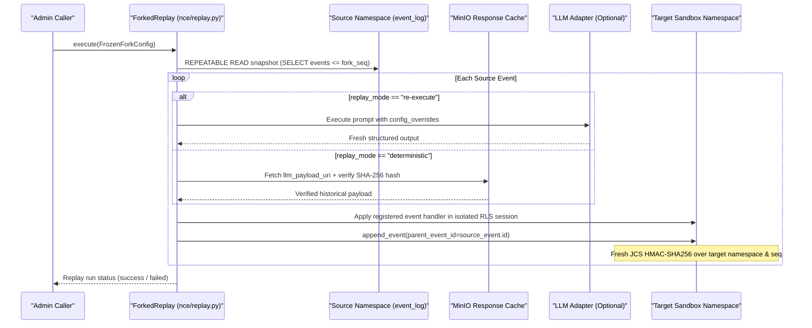

> **Status:** shipped · **Verified-against:** 236e4dc (main) · **Last-audited:** 2026-11-19

# Deterministic Event Replay & Sandbox Forking

The replay subsystem (`nce/replay.py`) streams, reconstructs, or forks namespace state from the append-only WORM `event_log` for audit verification, regression testing, and isolated configuration comparisons.

---

## 1. Replay Modes

NCE implements three replay strategies mapped to dedicated classes in `nce/replay.py`:

| Mode | Class | Writes to Target Namespace? | External LLM Calls? | Outbound Actuation |
| :--- | :--- | :--- | :--- | :--- |
| **Observational** | `ObservationalReplay` | No (read-only cursor) | No | None |
| **Reconstructive** | `ReconstructiveReplay` | Yes (empty target namespace) | No | Fenced (`is_replay_sandbox`) |
| **Forked** | `ForkedReplay` | Yes (isolated target namespace) | Optional (`re-execute` only) | Fenced (`is_replay_sandbox`) |

### 1.1 Observational Replay (`ObservationalReplay`)

Streams `event_log` rows read-only for a `namespace_id` and sequence window using an `asyncpg` server-side cursor (`prefetch=50`) so large logs never materialize in Python heap memory. Every row's RFC 8785 JCS `HMAC-SHA256` signature is verified before yielding; any mismatch raises `DataIntegrityError` and aborts the stream.

```text
{"type": "event",    ...event_fields}
{"type": "progress", "run_id": "...", "events_streamed": N}
{"type": "complete", "run_id": "...", "events_streamed": N}
{"type": "error",    "run_id": "...", "message": "..."}
```

### 1.2 Forked Sandbox Replay (`ForkedReplay`)

Replays events from a source namespace up to `fork_seq` into a separate **target namespace** governed by an immutable `FrozenForkConfig` (Pydantic `frozen=True`):

- **`deterministic` sub-mode (default):** Serves historical model outputs from content-addressed MinIO objects (`event_log.llm_payload_uri`), verifying the object's `SHA-256` digest against `event_log.llm_payload_hash` before applying each event.
- **`re-execute` sub-mode:** Invokes the configured model adapter fresh (with optional `config_overrides` for `llm_provider`, `llm_model`, `llm_credentials`, `llm_temperature`) inside the isolated target namespace to evaluate prompt or model changes without touching source tenant rows.
- **Outbound Actuation & Webhook Fencing (`is_replay_sandbox`):** Target replay namespaces carry sandbox fencing metadata so outbound webhooks, ERP mutations, and hardware/OT connector write calls fail closed rather than re-triggering external side effects during replay.

### 1.3 Reconstructive Replay (`ReconstructiveReplay`)

Rebuilds state deterministically into an empty target namespace through `end_seq` without invoking external model providers, then computes `SHA-256` state digests over both namespaces and records `source_state_digest`, `target_state_digest`, and `digest_match` in `replay_runs`.

---

## 2. Forked Replay Execution Flow



---

## 3. Fork Provenance Lineage

Every event written into a forked target namespace preserves cryptographic lineage back to its source event:

- Deterministic fork event ID: `uuid5(target_namespace_id, str(source_event_id))` with its own monotonic `event_seq` and `occurred_at` in the target namespace.
- `parent_event_id` points to the **source event UUID**, allowing `get_event_provenance` to walk across fork boundaries.
- A fresh JCS `HMAC-SHA256` signature is computed over `(target namespace_id, target event_seq, target occurred_at, source parent_event_id)`.
- Cached model payloads for deterministic forks are copied to `nce-llm-payloads/fork/<target_ns>/<source_event_id>.json` so target retention and cleanup remain independent of the source namespace.

---

## 4. Exhaustive Handler Registry & Resumption

`ForkedReplay.__init__` and `ReconstructiveReplay.__init__` call `_validate_handler_coverage()` against the complete `EventType` union before processing row `1`; any unhandled `EventType` raises `ReplayHandlerMissingError` immediately.

| Event Type Group | Strategy in `nce/replay.py` | Target State Mutation |
| :--- | :--- | :--- |
| `store_memory` | `_handle_store_memory` | `INSERT` into `memories`, copy MongoDB payload, carry `memory_salience` |
| `forget_memory` | `_handle_forget_memory` | `UPDATE memories SET valid_to` |
| `boost_memory` | `_handle_boost_memory` | `UPSERT memory_salience` |
| `resolve_contradiction` | `_handle_resolve_contradiction` | `UPDATE contradictions` + ATMS invalidation |
| `consolidation_run` | `_handle_consolidation_run` | `INSERT memories` + `kg_nodes` / `kg_edges` + `memory_salience` |
| `pii_redaction`, `snapshot_created`, `unredact` | Provenance handlers | Appends audit lineage row to target `event_log` |
| Namespace / migration / saga / A2A audit events | `_handle_fork_provenance_only` | Appends audit lineage row to target `event_log` |

### Crash Resumption & `replay_runs` Ledger

`replay_runs` (`nce/schema.sql`, extended by `014_replay_runs_digest.sql`) enforces `FORCE ROW LEVEL SECURITY` (`source_namespace_id = get_nce_namespace()`) and checkpoints progress every `10` events. On restart with `_existing_run_id`, the engine queries `MAX(event_seq)` already tagged with `params->>'replay_run_id'` in the target namespace and resumes at `prior_max + 1`. Each event executes inside its own Saga transaction.

---

## 5. Admin MCP Tools

All replay tools require `admin` scope (`admin_api_key` on `stdio` or `admin`-scoped token on `/mcp`):

| Tool | Required Parameters | Mechanical Behavior |
| :--- | :--- | :--- |
| `replay_observe` | `namespace_id` | Read-only HMAC-verified stream (`start_seq`, `end_seq`, `agent_id_filter`, `max_events` default `500`) |
| `replay_fork` | `source_namespace_id`, `target_namespace_id`, `fork_seq` | Launches async `deterministic` or `re-execute` sandbox fork; returns `run_id` |
| `replay_reconstruct` | `source_namespace_id`, `target_namespace_id`, `end_seq` | Reconstructs state into an empty namespace and verifies SHA-256 state digest |
| `replay_status` | `run_id` | Returns status, `events_applied`, `digest_match`, and error details |
| `get_event_provenance` | `memory_id` | Walks `parent_event_id` up to `50` hops, verifying each hop's HMAC signature |

```json
{
  "source_namespace_id": "00000000-0000-4000-8000-000000000001",
  "target_namespace_id": "00000000-0000-4000-8000-000000000002",
  "fork_seq": 120,
  "replay_mode": "re-execute",
  "config_overrides": {
    "llm_provider": "anthropic",
    "llm_model": "claude-sonnet-4-5",
    "llm_temperature": 0.2
  }
}
```
