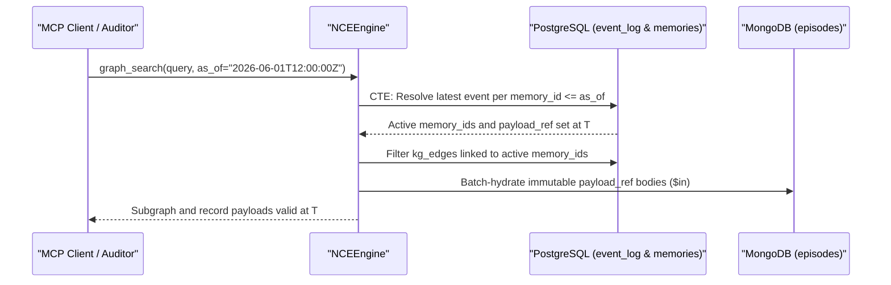
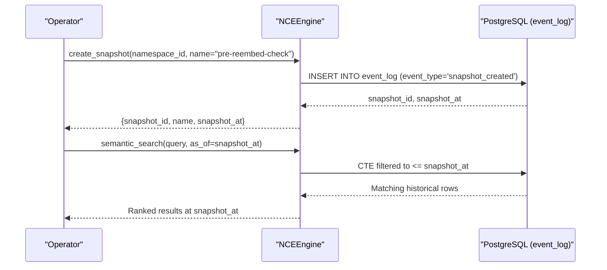

> **Status:** shipped · **Verified-against:** 236e4dc (main) · **Last-audited:** 2026-11-19

# Point-in-Time Temporal Queries (`as_of`)

> **Note on Filename:** This document retains the path `docs/time_travel.md` so inbound references remain stable. It documents deterministic point-in-time SQL filtering (`as_of`) and named snapshot markers over NCE's append-only history.

Point-in-time querying allows MCP clients, auditors, and test harnesses to evaluate retrieval and graph queries against the exact record state that was active at an earlier UTC timestamp `T`.

---

## 1. Append-Only Temporal Foundation

Rather than overwriting or hard-deleting rows in place, NCE tracks state transitions through two coordinated mechanisms:

1. **Row Validity Intervals (`valid_from` / `valid_to`):** Records in `memories` and `kg_edges` carry `TIMESTAMPTZ` validity bounds (`valid_from <= as_of AND (valid_to IS NULL OR valid_to > as_of)`).
2. **Append-Only WORM `event_log`:** Every `store_memory`, `forget_memory`, `boost_memory`, and `snapshot_created` mutation appends an immutable, JCS `HMAC-SHA256`-signed row to `event_log` (`prevent_mutation` trigger blocks `UPDATE` and `DELETE`).

---

## 2. `as_of` Query Surface

All `as_of` parameters accept an ISO-8601 UTC timestamp string (for example, `"2026-06-15T10:00:00Z"`). Omitting `as_of` queries the current active set (`valid_to IS NULL`).

| MCP Tool | Temporal Query Behavior |
| :--- | :--- |
| `semantic_search` | Evaluates 3-way Hybrid RRF restricted to records active at `as_of` |
| `graph_search` | Runs `WITH RECURSIVE` BFS traversal over `kg_edges` linked to records active at `as_of` |
| `neuromorphic_search` | Runs weighted `WITH RECURSIVE` graph traversal restricted to the active set at `as_of` |
| `get_recent_context` | Returns most recent raw interaction/document records (`episodic`) created at or before `as_of` |
| `explain_past_decision` | Reconstructs historical record state and signed `event_log` receipts as of `as_of` |
| `verify_memory` | Verifies JCS `HMAC-SHA256` integrity and `parent_event_id` provenance chain as of `as_of` |
| `compare_states` | Computes set and ranking diffs between `as_of_a` and `as_of_b` |

### Point-in-Time Query Execution Flow



---

## 3. Active-Set Reconstruction Rules

Active-set resolution at timestamp $T$ follows the event types declared in `nce/event_types.py`:

| Rule | Latest Event `<= T` | Effect on Active Set at `T` |
| :--- | :--- | :--- |
| **Include** | `store_memory` | Record is included using the `payload_ref` recorded on that event |
| **Exclude** | `forget_memory` (or no event `<= T`) | Record is excluded from results at `T` |
| **Score Override** | `boost_memory` | Applies the `salience_score` recorded by the latest `boost_memory` event `<= T` |

> [!NOTE]
> Shadow-column embedding migrations (`docs/migrations.md`) write new `store_memory`-family events through the migration Saga rather than mutating historical `event_log` rows. Because MongoDB payloads are content-immutable per `ObjectId` (`payload_ref` in `EVENT_REQUIRED_PARAM_KEYS["store_memory"]`), hydrating `payload_ref` from the matched `event_log` row returns the exact historical document text.

---

## 4. Named Point-in-Time Snapshots & Diffs

Operators can bind a human-readable label to a `TIMESTAMPTZ` marker without duplicating underlying table or blob storage:

```text
create_snapshot(namespace_id, name, snapshot_at?, agent_id?, metadata?)
list_snapshots(namespace_id)
delete_snapshot(namespace_id, snapshot_id)
compare_states(namespace_id, as_of_a, as_of_b, query?, top_k?)
```



| Tool | Required Parameters | Optional Parameters |
| :--- | :--- | :--- |
| `create_snapshot` | `namespace_id`, `name` | `snapshot_at`, `agent_id`, `metadata` |
| `list_snapshots` | `namespace_id` | — |
| `delete_snapshot` | `namespace_id`, `snapshot_id` | — |
| `compare_states` | `namespace_id`, `as_of_a`, `as_of_b` | `query`, `top_k` |

### Practical Engineering Uses

- **Post-Incident Audit:** Inspect the exact records and graph edges returned to an MCP workflow when a past action or approval request was generated.
- **Regression Baselines:** Pin a `snapshot_at` marker before running batch summarization or re-embedding jobs, then diff retrieval output with `compare_states`.
- **Replay Seeding:** Choose a known `event_seq` / `snapshot_at` boundary before launching an isolated sandbox fork via [docs/replay.md](replay.md).
